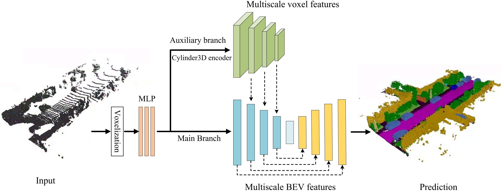

# DPS2CNet
The pytorch implementation for DPS2CNet in paper ["A Dual-Path Network for Semantic Scene Completion of Single-Frame LiDAR Point Clouds"](https://www.sciencedirect.com/science/article/pii/S1569843225006673)on ["International Journal of Applied Earth Observation and Geoinformation "](https://www.sciencedirect.com/journal/international-journal-of-applied-earth-observation-and-geoinformation).
## A Dual-Path Network for Semantic Scene Completion of Single-Frame LiDAR Point Clouds



## Installation

### Requirements
- PyTorch
- pyyaml
- mmcv>=2.1.0
- tqdm
- numba
- mmsegmentation
- torch-scatter
- spconv >= 2.1

## Data Preparation

### SemanticKITTI
```
./
├── 
├── ...
└── path_to_data_shown_in_config/
    ├──sequences
        ├── 00/           
        │   ├── velodyne/	
        |   |	├── 000000.bin
        |   |	├── 000001.bin
        |   |	└── ...
        │   └── labels/ 
        |       ├── 000000.label
        |       ├── 000001.label
        |       └── ...
        │   └── voxels/ 
        |       ├── 000000.bin
        |       ├── 000000.label
        |       ├── 000000.invalid
        |       ├── 000000.occluded
        |       ├── 000001.bin
        |       ├── 000001.label
        |       ├── 000001.invalid
        |       ├── 000001.occluded
        |       └── ...
        ├── 08/ # for validation
        ├── 11/ # 11-21 for testing
        └── 21/
	    └── ...
```
# Train
```
python train.py

```

# Citation
If you find this repo useful for your research, please consider citing the paper as follows:
```
@article{liu2026dual,
  title={A dual-path network for semantic scene completion of single-frame LiDAR point clouds},
  author={Liu, Wei and Kang, Ziwen and Yu, Yongtao and Gong, Zheng and Zheng, Yuchao and Huang, Xiaohui and Guan, Haiyan and Ma, Lingfei and Zhang, Dedong},
  journal={International Journal of Applied Earth Observation and Geoinformation},
  volume={146},
  pages={105020},
  year={2026},
  publisher={Elsevier}
}
```
